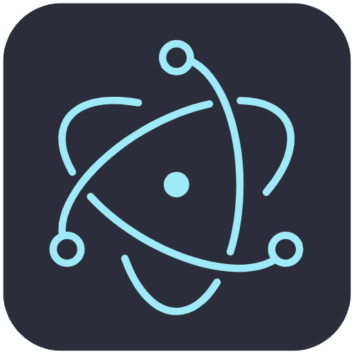

<p align="center">
  
</p>

<h1 align="center">SpeakEasy</h1>

<p align="center">
  <strong>Write and speak with your eyes.</strong><br />
  Enter initials, review a suggested phrase, and choose when to say it out loud.
</p>

<p align="center">
  
  
  <a href="LICENSE"></a>
</p>

<p align="center">
  <a href="#install-speakeasy">Install</a> ·
  <a href="#quick-start">Quick start</a> ·
  <a href="#eye-tracking">Eye tracking</a> ·
  <a href="#provider-setup">Provider setup</a> ·
  <a href="#development">Development</a>
</p>

SpeakEasy is a desktop augmentative and alternative communication (AAC) app. It combines
Dasher-style continuous letter entry with SpeakFaster-style phrase suggestions. You can steer with
a mouse, use the built-in webcam gaze or head pointer, and dwell on controls to select them.

## Why SpeakEasy

- **Enter less text.** Steer through the first letter of each word, then review suggested phrases.
- **Keep control of the wording.** Change a word in a suggestion, spell it yourself, or write the
  entire message in exact spelling mode.
- **Choose when to speak.** Review the message and voice settings, then select **Speak** to read it aloud.

## Project status

SpeakEasy is in development. A webcam gaze path is built in and has been exercised with real
calibration data. Dedicated eye trackers that move the desktop pointer can be tried in **Mouse**
mode. The project has yet to publish model-specific compatibility results.

## Install SpeakEasy

Use Git, Node.js 24, and npm. The first install downloads Electron and the webcam model.

```sh
git clone --branch dev https://github.com/Luke-Pitstick/SpeakEasy.git
cd SpeakEasy
npm ci
npm run dev
```

You can try steering and exact spelling without provider accounts. See the
[setup guide](docs/setup.md) for camera permissions, eye-tracker setup, and cloud features.

## Quick start

1. **Enter initials.** Select **Start writing**, then steer right toward the letter you want.
   Steer left to reverse. Try `iwac` for a sentence such as “I want a coffee.”
2. **Review a suggestion.** Choose **Show phrases** to request suggestions, then select one to
   review. Fresh suggestions require [cloud generation](#provider-setup).
3. **Correct a word.** Select the word you want to change. Choose **Find replacements** for
   same-initial options, or choose **Spell word**, enter the replacement in Dasher, and select
   **Use word**.
4. **Speak.** When the reviewed wording is ready, select **Speak**. This requires Cartesia.
   For manual composition, choose **Menu → Exact spelling** and write the full message directly.

## Eye tracking

| Input                       | Setup                                                                                                                | Verification                                               |
| --------------------------- | -------------------------------------------------------------------------------------------------------------------- | ---------------------------------------------------------- |
| Mouse or trackpad           | Choose **Mouse** in **Menu → Settings → General**.                                                                   | Standard desktop pointer path.                             |
| Built-in or external webcam | Choose **Eye tracker (webcam)** and **Calibrate eye tracker**, or choose **Head pointer (webcam)** and center it.    | Webcam gaze has been exercised with real calibration data. |
| Dedicated eye tracker       | Calibrate in the tracker software and enable continuous desktop pointer movement. Leave SpeakEasy in **Mouse** mode. | Model-specific compatibility is unverified.                |

Enable **Dwell activation** in General settings to select by holding the pointer on a control.
See [input setup and troubleshooting](docs/setup.md#input-setup) and the
[tracker compatibility report template](.github/ISSUE_TEMPLATE/tracker-compatibility.md).

## Provider setup

| Feature                                      | Required credentials                                            |
| -------------------------------------------- | --------------------------------------------------------------- |
| New phrase suggestions and cloud refinements | `OPENROUTER_TOKEN`, `MOSS_PROJECT_ID`, and `MOSS_PROJECT_TOKEN` |
| Speech playback and live transcription       | `CARTESIA_API_KEY`                                              |
| Optional Jev tone suggestions                | `TYPESAFE_AI_API_TOKEN`                                         |

The [provider setup guide](docs/setup.md#cloud-features) explains how to supply credentials,
enable generation, and see which data goes to each service.

## Development

| Command                                            | Purpose                                                    |
| -------------------------------------------------- | ---------------------------------------------------------- |
| `npm run dev`                                      | Open Electron in development mode with renderer hot reload |
| `npm run assets:eye-tracking`                      | Prepare the webcam model and WASM assets                   |
| `npm run lint`                                     | Check source with ESLint                                   |
| `npm test`                                         | Run the test suite                                         |
| `npm run typecheck`                                | Check TypeScript across the application and model tooling  |
| `npm run build`                                    | Typecheck and build into `out/`                            |
| `npm start`                                        | Preview the built app                                      |
| `npm run build:mac`, `build:win`, or `build:linux` | Package for the corresponding operating system             |

## CI and releases

Open feature pull requests into `dev` and promote `dev` through a pull request into `main`. The **Checks** job runs lint, tests, and the production build on pull requests into either branch. Require **Checks** in the branch rules to enforce a passing build before merge.

After a merge to `main`, download the installers from the Actions run. The workflow packages an Apple Silicon macOS DMG, a Windows x64 installer, and Linux x64 AppImage and Debian packages. These builds are for testing. macOS notarization and Windows release signing require signing credentials and configuration.

To cut a release, update `package.json` and `package-lock.json` to the intended version through a pull request, then push the matching `v` tag on the merged commit. For example, for version `0.1.0`, run `git tag v0.1.0 <main-commit>` and `git push origin v0.1.0`. Once all installers build, Actions creates a draft GitHub release with the downloads and generated notes. Review the draft and publish it from GitHub Releases when it's ready.

## Further reading

- [Technical overview](docs/technical-overview.md) covers the composition, generation, memory, and voice architecture.
- [Initials prediction](docs/initials-ppm-integration.md) describes the local model and its provenance.
- [Source manifest](docs/source-manifest.md) and [third-party notices](THIRD_PARTY_NOTICES.md) credit the code and data SpeakEasy builds on.

SpeakEasy is licensed under [GPL-3.0-only](LICENSE).
