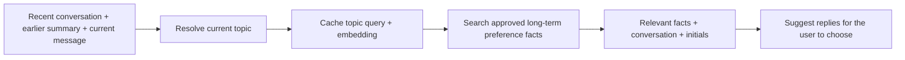

# SpeakEasy: short-term and long-term memory

## A short explanation for presenting

“SpeakEasy uses short-term memory to understand the current conversation and long-term memory to remember what the user has taught it. Short-term memory holds the latest eight conversation turns, a summary of earlier dialogue, and a cached search query describing the current topic. Long-term memory stores committed sentences, corrected vocabulary, and preferences the user has reviewed and approved. When suggesting a reply, the app uses the current topic to find relevant saved facts. That lets it remember that your favorite Clash Royale deck is Hog Cycle, leave that fact out while discussing dinner, and retrieve it again when you return to the game.”

## What each kind of memory holds

|              | Short-term memory                                                                                                                               | Long-term memory                                                                                                                                                 |
| ------------ | ----------------------------------------------------------------------------------------------------------------------------------------------- | ---------------------------------------------------------------------------------------------------------------------------------------------------------------- |
| Purpose      | Understand what the user is responding to now.                                                                                                  | Personalize future communication using confirmed language and approved facts.                                                                                    |
| Contents     | Eight recent turns, a summary of older turns, and the current topic query and its embedding.                                                    | Committed sentences and initials; corrections and learned vocabulary when correction learning is enabled; reviewed preference facts and their search embeddings. |
| Location     | Application memory for the current session.                                                                                                     | Local storage on the device. Corrections and preference records use SQLite; the saved-phrase cache uses a local JSON file.                                       |
| Lifetime     | Recent turns roll into the summary. Context changes replace the topic cache on the next retrieval. Restarting the app discards session context. | Persists across restarts until forgotten or cleared, subject to storage limits.                                                                                  |
| User control | Review or edit recent turns, forget earlier summarized context, or clear the conversation.                                                      | Review learned vocabulary and facts; edit or forget individual records. Extracted preferences require approval before retrieval.                                 |

## How they work together

1. **Keep the conversation available.** Confirmed sentences and partner turns enter the recent window. With Gemini enabled, older turns are condensed into a session-only summary capped at 2,000 characters. Speaking or starting a new message preserves that context.
2. **Identify the current subject.** Gemini turns the permitted context into a short search query, such as “preferred Clash Royale deck.” While the user is composing multiple sentences, the first locked sentence establishes the topic, and the next sentence is treated as a follow-up. Background transcription has lower priority. Explicit user wording can change the subject; once the message is finished, recent questions guide the next reply. Older context helps resolve follow-ups such as “which one?” The topic is stored as a query, rather than a fixed category label.
3. **Reuse the topic while context stays the same.** The main process caches one resolved query and its embedding. Changing initials reuses them. Changes to conversation text, summary, draft, preceding locked sentences, or locked words refresh the cache on the next retrieval. Saved facts are checked afresh each time.
4. **Retrieve relevant personal information.** The query embedding is compared with approved fact embeddings. Up to three sufficiently similar facts go to expansion within a size budget. Initials, prefixes, and locked words still constrain the suggested wording. Correction vocabulary and saved phrases provide additional support through their own matching paths.

## Example: remembering a preference without getting stuck on a topic

Assume the user has approved the fact **“My favorite Clash Royale deck is Hog Cycle.”**

| Current conversation                                    | Resolved topic                                | Preference retrieval            |
| ------------------------------------------------------- | --------------------------------------------- | ------------------------------- |
| “Which deck do you prefer?” in the game discussion      | Preferred Clash Royale deck                   | Retrieves Hog Cycle.            |
| “What would you like for dinner: hot chicken or pasta?” | Dinner preference                             | Excludes the Hog Cycle fact.    |
| “Which would you pick?”                                 | The dinner choice from the preceding question | Continues to exclude Hog Cycle. |
| “Back to Clash Royale: which deck?”                     | Preferred Clash Royale deck                   | Retrieves Hog Cycle again.      |

The earlier discussion remains in short-term context, and the approved preference remains in long-term storage. Relevance changes with the current question. This sequence passed a live test with real topic resolution, embeddings, and expansion; it is evidence for this scenario rather than a guarantee for every conversation.

## Privacy and limits

Storage is local, but enabled cloud features send permitted text to Gemini and embedding requests to OpenAI through OpenRouter. Generation, correction-memory sharing, preference extraction, and semantic retrieval have their respective controls. Zod validates structured preference proposals and topic queries. A temporary summary does not automatically become an approved preference, and model suggestions alone do not teach confirmed usage. If retrieval fails, composition continues without preference facts.

Implementation details and test evidence: [Preference memory](./preference-memory.md) and [Correction memory](./correction-memory.md).
