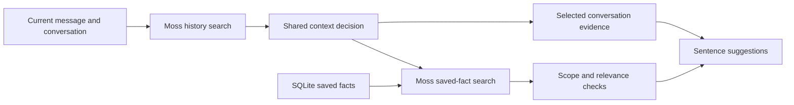

# Short-term and long-term memory

SpeakEasy uses Moss to find context relevant to the current reply and to retrieve preferences grounded in messages the user has confirmed. SQLite keeps durable source records; local Moss sessions are disposable search indexes. One shared context decision guides both conversation selection and preference retrieval, so they use the same current topic.

|           | Short-term context                                                                             | Long-term memory                                                                                  |
| --------- | ---------------------------------------------------------------------------------------------- | ------------------------------------------------------------------------------------------------- |
| Contents  | Up to 500 finalized conversation turns / 250,000 characters, with eight recent turns editable. | Committed sentences, exact correction vocabulary, and automatically learned preference facts.     |
| Lifetime  | Current app session; explicit clear and forget controls remove retained context.               | Persists locally across restarts until forgotten.                                                 |
| Retrieval | Moss finds earlier evidence; a validated context decision selects relevant source turns.       | Moss ranks permitted saved preferences; exact correction and saved-phrase lookup remain separate. |

Explicit words and the unfinished authored message take priority over background conversation. Earlier turns supply missing references or support a return to an earlier subject. If the user moves from a Clash Royale question to dinner, the current context should select dinner evidence and exclude the unrelated deck preference. Returning to the game can retrieve that preference again.

Changing initials reuses an unchanged context decision. Editing conversation or forgetting a source invalidates pending results and updates the local indexes. Unselected suggestions and partial transcripts do not become memories. Confirmed messages teach grounded preferences automatically when Gemini is enabled. The person communicating through SpeakEasy is the app user; partner microphone speech remains context. Sharing saved facts remains separately controlled.

Search and embeddings run locally, but enabled context decisions, extraction, and generation use OpenRouter. Moss requires service access for authentication/model loading and sends usage telemetry. A provider failure is visible and leaves manual composition available. No rolling summary or cloud-embedding retrieval path remains.

Local evaluation observed improved precision, one missed preference, and mixed evidence coverage on a small public-conversation sample. Adoption does not establish accuracy across arbitrary conversations or real AAC users. See [implementation and lifecycle details](./preference-memory.md).
